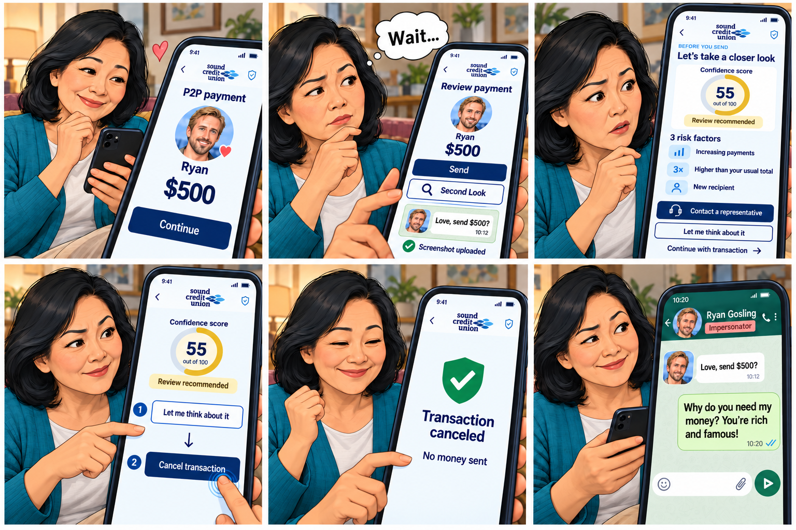

# Second Look (HuskyHack 2026)

## Romance scam comic

This six-frame storyboard follows a member reviewing a $500 P2P payment to someone impersonating Ryan Gosling. She uses Second Look to review a WhatsApp screenshot, considers the transaction risk factors, chooses “Let me think about it,” and cancels the payment before questioning the request on WhatsApp.

The comic uses the supplied Sound Credit Union interface design. Its illustrative score of 55 is a **confidence score**, where higher means greater confidence. The prototype's risk score uses a different scale, as described in [DESIGN.md](DESIGN.md).
